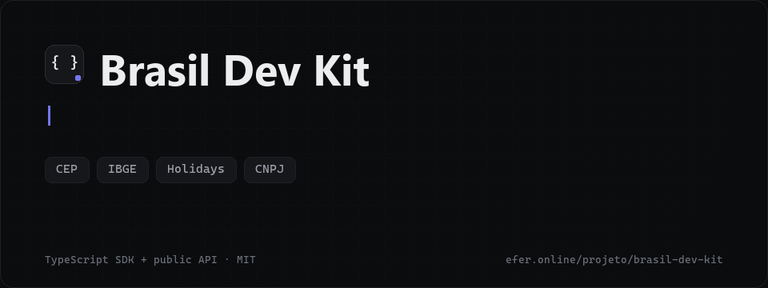
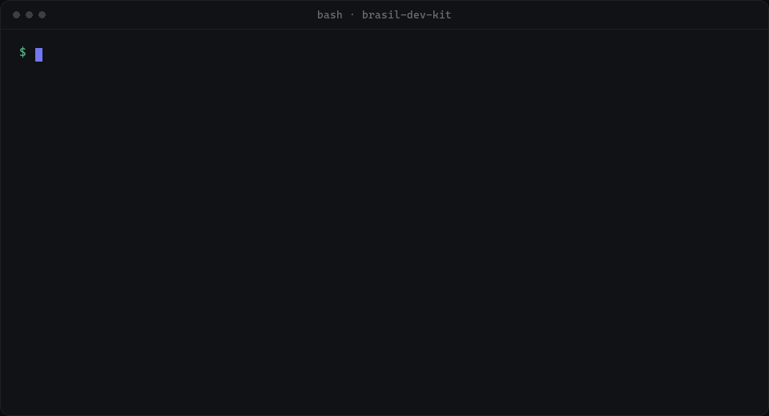
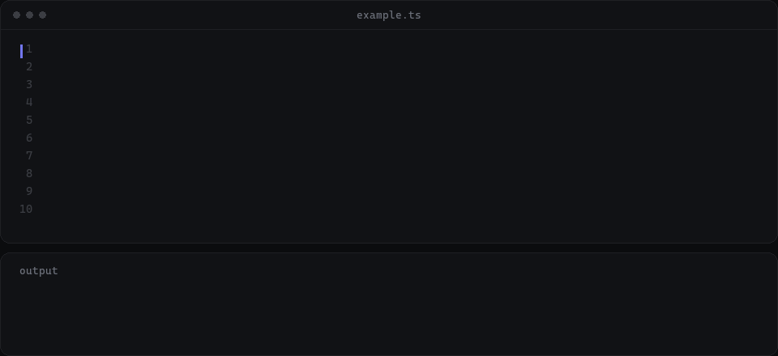

<div align="center">

<a href="https://efer.online/projeto/brasil-dev-kit/">
  
</a>

<br><br>

[](https://github.com/Efer-Eder/brasil-dev-kit/actions/workflows/ci.yml)
[](https://efer.online/api/brasil-dev-kit/)
[](LICENSE)
[](tsconfig.json)
[](package.json)
[](https://github.com/Efer-Eder/brasil-dev-kit/stargazers)

**[Project page](https://efer.online/projeto/brasil-dev-kit/)** ·
**[Try the API](https://efer.online/projeto/brasil-dev-kit/#api)** ·
[Docs (pt-BR)](docs/) ·
[Roadmap](ROADMAP.md) ·
[Português](README.md)

</div>

---

CEP (Brazilian postal codes), IBGE states and municipalities, national holidays
and CNPJ (company tax ID) validation, including the new **alphanumeric** CNPJ, in a
**TypeScript SDK** and a **public HTTP API**. Every response says where the data
came from, every error has a stable code, and nothing depends on a paid key.

> [!NOTE]
> **Work in progress.** The SDK is not on npm yet (use it from source) and the API
> is free, with no availability guarantee. This README only shows what already
> exists; the rest is in the [ROADMAP](ROADMAP.md).

## Try it now

Nothing to install, straight from your terminal:

<a href="docs/assets/readme/terminal-en.gif"></a>

```powershell
curl https://efer.online/api/brasil-dev-kit/v1/cep/01310-100
curl https://efer.online/api/brasil-dev-kit/v1/feriados/2026
curl https://efer.online/api/brasil-dev-kit/v1/ibge/ufs/SP/municipios
curl https://efer.online/api/brasil-dev-kit/v1/cnpj/12ABC34501DE35
```

Rather click? The [project page](https://efer.online/projeto/brasil-dev-kit/) has a
playground that calls the API live.

## What's inside

| Module        | What it does                                                             | Where the data comes from                          | Network? |
| ------------- | ------------------------------------------------------------------------ | -------------------------------------------------- | -------- |
| **CEP**       | Normalized address, with the provider that answered                      | ViaCEP, falling back to BrasilAPI                  | yes      |
| **IBGE**      | The 27 states and their municipalities, with regional divisions          | IBGE Localidades API                               | yes      |
| **Holidays**  | National holidays and federal optional days off for a year               | Federal laws and yearly federal decrees            | no       |
| **CNPJ**      | Format and check digits, numeric and alphanumeric                        | Official check-digit manual (IN RFB nº 2.229/2024) | no       |
| **HTTP core** | Timeout, `AbortSignal`, retries with backoff, TTL cache and typed errors |                                                    |          |

Field names in responses are in Portuguese (`municipio`, `logradouro`, `fonte`…),
matching the official sources. Module docs (pt-BR): [CEP](docs/cep.md) ·
[IBGE](docs/ibge.md) · [Holidays](docs/feriados.md) · [CNPJ](docs/cnpj.md).

## In your code

<a href="docs/assets/readme/sdk-en.gif"></a>

```powershell
git clone https://github.com/Efer-Eder/brasil-dev-kit.git
cd brasil-dev-kit
pnpm install
pnpm build
```

```ts
import {
  createCepClient,
  createIbgeClient,
  getFeriadosNacionais,
  validateCnpj,
  NotFoundError,
} from 'brasil-dev-kit';

const cep = createCepClient({ timeoutMs: 8000, cacheTtlMs: 60_000 });

try {
  const endereco = await cep.lookup('01310-100');
  // { uf: 'SP', municipio: 'São Paulo', logradouro: 'Avenida Paulista', fonte: { provedor: 'viacep' }, ... }
} catch (error) {
  if (error instanceof NotFoundError) console.log('No such CEP');
}

// Transient failures (network, 5xx, timeout, 429) are retried with exponential backoff and jitter.
const ibge = createIbgeClient({ retry: { retries: 3, maxDelayMs: 4000 }, cacheTtlMs: 86_400_000 });

await ibge.listMunicipios('RR'); // 15 municipalities, sorted by name
getFeriadosNacionais(2026).origem; // 'portaria': official holidays + optional days off
validateCnpj('12.ABC.345/01DE-35').kind; // 'alphanumeric'
```

> [!IMPORTANT]
> CNPJ validation checks **format and check digits only**. It does not tell you
> whether the company exists or is active at Receita Federal.

## Public API

Base: **`https://efer.online/api/brasil-dev-kit/`**

| Route                              | Returns                                          |
| ---------------------------------- | ------------------------------------------------ |
| `GET /v1/cep/{cep}`                | Normalized address                               |
| `GET /v1/ibge/ufs`                 | States with region                               |
| `GET /v1/ibge/ufs/{uf}/municipios` | Municipalities of a state (code or abbreviation) |
| `GET /v1/feriados/{ano}`           | Holidays and optional days off                   |
| `GET /v1/cnpj/{cnpj}`              | CNPJ validation                                  |
| `GET /v1/health`                   | API health                                       |

| Limit                | Value                                                    |
| -------------------- | -------------------------------------------------------- |
| Requests per IP      | 10/s, burst of 30 (above that: `429` with `Retry-After`) |
| CEP cache            | 7 days (not found: 6 h)                                  |
| Timeout per provider | 4 s                                                      |
| Measured throughput  | ~880 req/s with a warm cache, on half a CPU              |

Errors are always JSON: `{ "erro": { "codigo": "NOT_FOUND", "mensagem": "..." } }`.
Routes, error codes and the capacity math (pt-BR): [docs/api.md](docs/api.md).

## Typed errors

| Class                      | `code`                 | When                                           |
| -------------------------- | ---------------------- | ---------------------------------------------- |
| `ValidationError`          | `VALIDATION_ERROR`     | Invalid input (no request is made)             |
| `NotFoundError`            | `NOT_FOUND`            | The data does not exist at the provider        |
| `RateLimitError`           | `RATE_LIMIT`           | The provider rate limited (has `retryAfterMs`) |
| `TimeoutError`             | `TIMEOUT`              | The time limit was exceeded                    |
| `ProviderUnavailableError` | `PROVIDER_UNAVAILABLE` | Network, 5xx or malformed response             |
| `HttpError`                | `HTTP_ERROR`           | Any other unexpected HTTP status               |

All of them extend `BrasilDevKitError`.

## Running locally

Requires **Node.js ≥ 22.12**, Git and **pnpm 12** (without a global pnpm, use
`npx pnpm@12.21.0`).

```powershell
pnpm install
pnpm run check               # lint + typecheck + tests + build
pnpm test:integration        # optional: tests against the real APIs
node dist-server/server.js   # local API at http://127.0.0.1:8795
node examples/node/cep.mjs 01310-100
```

The GIFs in this README are generated by
[`scripts/readme-gifs/make_gifs.py`](scripts/readme-gifs/make_gifs.py) from real API
and SDK output.

## Documentation (pt-BR)

- [Public API: routes, errors and capacity](docs/api.md) · [Deploy](docs/deploy.md)
- [CEP](docs/cep.md) · [IBGE](docs/ibge.md) · [Holidays](docs/feriados.md) · [CNPJ](docs/cnpj.md)
- [Architecture](docs/architecture.md) · [Decisions (ADRs)](docs/adr/)
- [Progress](PROGRESS.md) · [Roadmap](ROADMAP.md) · [Changelog](CHANGELOG.md)

## Contributing

Issues and pull requests are welcome. See [CONTRIBUTING](CONTRIBUTING.md): every
integration cites the official documentation and ships with tests against real
recorded responses. Security issues: [SECURITY](SECURITY.md).

---

<div align="center">

[MIT](LICENSE) © Efer Eder · made at [efer.online](https://efer.online)

</div>
