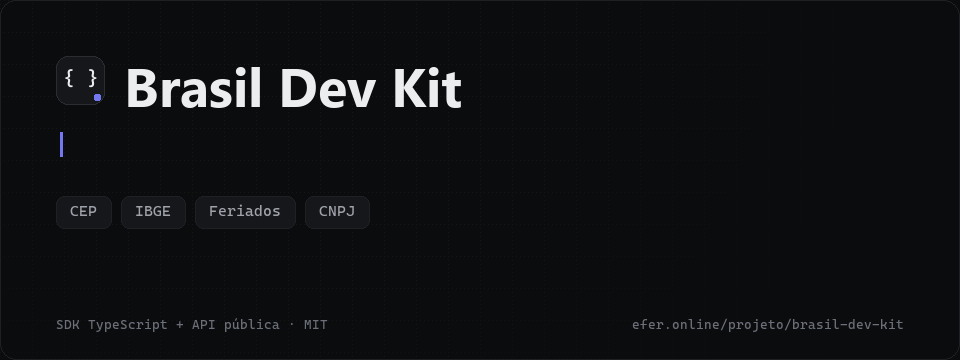
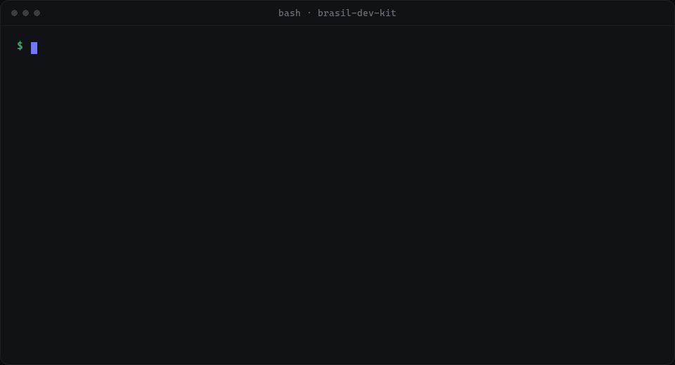
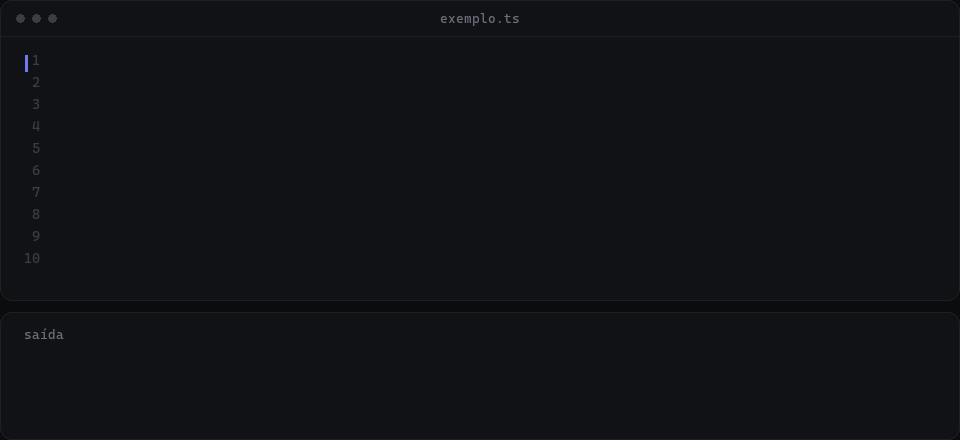

<div align="center">

<a href="https://efer.online/projeto/brasil-dev-kit/">
  
</a>

<br><br>

[](https://github.com/Efer-Eder/brasil-dev-kit/actions/workflows/ci.yml)
[](https://efer.online/api/brasil-dev-kit/)
[](LICENSE)
[](tsconfig.json)
[](package.json)
[](https://github.com/Efer-Eder/brasil-dev-kit/stargazers)

**[Página do projeto](https://efer.online/projeto/brasil-dev-kit/)** ·
**[Testar a API](https://efer.online/projeto/brasil-dev-kit/#api)** ·
[Documentação](docs/) ·
[Roadmap](ROADMAP.md) ·
[English](README.en.md)

</div>

---

CEP, UFs e municípios do IBGE, feriados nacionais e validação de CNPJ (inclusive
o **alfanumérico**) num **SDK TypeScript** e numa **API HTTP pública**. Cada
resposta diz de onde veio o dado, todo erro tem um código estável e nada depende
de chave paga.

> [!NOTE]
> **Em desenvolvimento.** O SDK ainda não está no npm (use a partir do código) e a
> API é gratuita, sem garantia de disponibilidade. Este README só mostra o que já
> existe; o resto está no [ROADMAP](ROADMAP.md).

## Experimente agora

Sem instalar nada, direto do terminal:

<a href="docs/assets/readme/terminal-pt.gif"></a>

```powershell
curl https://efer.online/api/brasil-dev-kit/v1/cep/01310-100
curl https://efer.online/api/brasil-dev-kit/v1/feriados/2026
curl https://efer.online/api/brasil-dev-kit/v1/ibge/ufs/SP/municipios
curl https://efer.online/api/brasil-dev-kit/v1/cnpj/12ABC34501DE35
```

Prefere clicar? A [página do projeto](https://efer.online/projeto/brasil-dev-kit/)
tem um playground que chama a API ao vivo.

## O que tem aqui

| Módulo        | O que faz                                                              | De onde vem o dado                                  | Rede? |
| ------------- | ---------------------------------------------------------------------- | --------------------------------------------------- | ----- |
| **CEP**       | Endereço normalizado, com o provedor que respondeu                     | ViaCEP, com fallback para BrasilAPI                 | sim   |
| **IBGE**      | 27 UFs e os municípios de cada uma, com divisões regionais             | API de Localidades do IBGE                          | sim   |
| **Feriados**  | Feriados nacionais e pontos facultativos federais do ano               | Leis federais e portarias anuais do governo federal | não   |
| **CNPJ**      | Formato e dígitos verificadores, numérico e alfanumérico               | Manual oficial de DV (IN RFB nº 2.229/2024)         | não   |
| **Core HTTP** | Timeout, `AbortSignal`, retries com backoff, cache TTL e erros tipados |                                                     |       |

Detalhes e fontes de cada módulo: [CEP](docs/cep.md) · [IBGE](docs/ibge.md) ·
[Feriados](docs/feriados.md) · [CNPJ](docs/cnpj.md).

## No seu código

<a href="docs/assets/readme/sdk-pt.gif"></a>

```powershell
git clone https://github.com/Efer-Eder/brasil-dev-kit.git
cd brasil-dev-kit
pnpm install
pnpm build
```

```ts
import {
  createCepClient,
  createIbgeClient,
  getFeriadosNacionais,
  validateCnpj,
  NotFoundError,
} from 'brasil-dev-kit';

const cep = createCepClient({ timeoutMs: 8000, cacheTtlMs: 60_000 });

try {
  const endereco = await cep.lookup('01310-100');
  // { uf: 'SP', municipio: 'São Paulo', logradouro: 'Avenida Paulista', fonte: { provedor: 'viacep' }, ... }
} catch (error) {
  if (error instanceof NotFoundError) console.log('CEP não existe');
}

// Falha passageira (rede, 5xx, timeout, 429) é repetida com backoff exponencial e jitter.
const ibge = createIbgeClient({ retry: { retries: 3, maxDelayMs: 4000 }, cacheTtlMs: 86_400_000 });

await ibge.listMunicipios('RR'); // 15 municípios, ordenados por nome
getFeriadosNacionais(2026).origem; // 'portaria': feriados + pontos facultativos oficiais
validateCnpj('12.ABC.345/01DE-35').kind; // 'alphanumeric'
```

> [!IMPORTANT]
> A validação de CNPJ confere **apenas formato e dígitos verificadores**. Ela não
> diz se a empresa existe ou está regular na Receita Federal.

## API pública

Base: **`https://efer.online/api/brasil-dev-kit/`**

| Rota                               | Devolve                            |
| ---------------------------------- | ---------------------------------- |
| `GET /v1/cep/{cep}`                | Endereço normalizado               |
| `GET /v1/ibge/ufs`                 | UFs com região                     |
| `GET /v1/ibge/ufs/{uf}/municipios` | Municípios da UF (sigla ou código) |
| `GET /v1/feriados/{ano}`           | Feriados e pontos facultativos     |
| `GET /v1/cnpj/{cnpj}`              | Validação de CNPJ                  |
| `GET /v1/health`                   | Saúde da API                       |

| Limite               | Valor                                                     |
| -------------------- | --------------------------------------------------------- |
| Requisições por IP   | 10/s, rajada de 30 (acima disso: `429` com `Retry-After`) |
| Cache de CEP         | 7 dias (inexistente: 6 h)                                 |
| Timeout por provedor | 4 s                                                       |
| Vazão medida         | ~880 req/s com cache quente, em meia CPU                  |

Erros sempre em JSON: `{ "erro": { "codigo": "NOT_FOUND", "mensagem": "..." } }`.
Rotas, códigos de erro e as contas de capacidade em [docs/api.md](docs/api.md).

## Erros tipados

| Classe                     | `code`                 | Quando                                        |
| -------------------------- | ---------------------- | --------------------------------------------- |
| `ValidationError`          | `VALIDATION_ERROR`     | Entrada inválida (nenhuma requisição é feita) |
| `NotFoundError`            | `NOT_FOUND`            | O dado não existe no provedor                 |
| `RateLimitError`           | `RATE_LIMIT`           | Provedor limitou (traz `retryAfterMs`)        |
| `TimeoutError`             | `TIMEOUT`              | Passou do tempo limite                        |
| `ProviderUnavailableError` | `PROVIDER_UNAVAILABLE` | Rede, 5xx ou resposta fora do formato         |
| `HttpError`                | `HTTP_ERROR`           | Outro status HTTP inesperado                  |

Todos herdam de `BrasilDevKitError`.

## Rodando localmente

Requisitos: **Node.js ≥ 22.12**, Git e **pnpm 12** (sem pnpm global, use
`npx pnpm@12.21.0`).

```powershell
pnpm install
pnpm run check               # lint + typecheck + testes + build
pnpm test:integration        # opcional: testa contra as APIs reais
node dist-server/server.js   # API local em http://127.0.0.1:8795
node examples/node/cep.mjs 01310-100
```

Os GIFs deste README são gerados por [`scripts/readme-gifs/make_gifs.py`](scripts/readme-gifs/make_gifs.py)
com saídas reais da API e do SDK.

## Documentação

- [API pública: rotas, erros e capacidade](docs/api.md) · [Deploy](docs/deploy.md)
- [CEP](docs/cep.md) · [IBGE](docs/ibge.md) · [Feriados](docs/feriados.md) · [CNPJ](docs/cnpj.md)
- [Arquitetura](docs/architecture.md) · [Decisões (ADRs)](docs/adr/)
- [Progresso](PROGRESS.md) · [Roadmap](ROADMAP.md) · [Changelog](CHANGELOG.md)

## Contribuindo

Issues e pull requests são bem-vindos. Leia o [CONTRIBUTING](CONTRIBUTING.md): toda
integração cita a documentação oficial e vem com testes contra respostas reais.
Vulnerabilidades: [SECURITY](SECURITY.md).

---

<div align="center">

[MIT](LICENSE) © Efer Eder · feito em [efer.online](https://efer.online)

</div>
